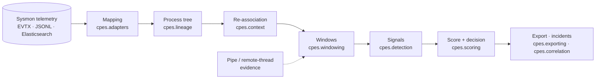

<div align="center">

# CPES — Contextual Privilege Escalation Scoring

**Which process actually gained privilege on a Windows host — and how?**

[](https://github.com/aaditripi18/CPES/actions/workflows/ci.yml)


[](LICENSE)

</div>

Most privilege-escalation rules look for a symptom: a process whose integrity
level is higher than its parent's. That misses escalations that cause no such
jump (a service binary started by `services.exe`, injected code, a stolen
token) and fires on legitimate software that elevates.

CPES reads Sysmon telemetry, rebuilds the process tree, **traces each privilege
gain back to the evidence of how it happened** (a hijacked registry key, a
dropped service binary, a remote thread, a named-pipe impersonation) and adds
signed evidence weights into a score. Every alert can be decomposed into the
signals, weights and raw records behind it.

```
powershell.exe  (Medium)                 ← actor: writes HKU\…_Classes\mscfile\shell\open\command
└─ eventvwr.exe (High)                   ← outcome: auto-elevating binary
   autoelevation_lolbin  +7.37  ≥ 0.5  →  DETECTED   (public sample, EVTX-ATTACK-SAMPLES)
```

## Quick start — the dashboard

```powershell
py -3.12 -m venv .venv; .\.venv\Scripts\Activate.ps1
pip install -r requirements.txt -r dashboard/requirements.txt
python scripts/fetch_external.py           # public attack captures + SigmaHQ rules, SHA-256 verified
cd dashboard/web; npm ci; npm run build; cd ../..
python dashboard/run_server.py             # http://127.0.0.1:8790
```

Or with Docker (no data is baked into the image; the public data is mounted read-only):

```powershell
docker build -t cpes-dashboard .
docker run --rm -p 127.0.0.1:8790:8790 -v "${PWD}/external:/app/external:ro" cpes-dashboard
```

What you can do in it:

- **Upload** Sysmon telemetry (JSONL, CSV or raw `.evtx`); every record is validated and rejections are listed with reasons.
- **Run CPES** and open any detection: score waterfall, signals, weights and the exact records behind each one.
- **Investigate** the reconstructed process tree; missing parents are drawn as gaps, never guessed.
- **Incidents**: CPES alerts joined with SigmaHQ rule matches, exported as a Markdown report, a MITRE ATT&CK Navigator layer, or ECS alerts for a SIEM.
- **Live**: replay a dataset as a stream, or poll an Elasticsearch index.
- **Evaluation**: re-run every protocol below with recorded provenance.

A five-minute walkthrough on public data only: [docs/DEMO.md](docs/DEMO.md).

## Results

Every protocol was written down with its expected outcome before it ran
([`docs/design/`](docs/design)); adverse outcomes are reported as they came out.
All tables are generated from `results/` into [docs/RESULTS.md](docs/RESULTS.md).

**Lab corpus** — one Windows 11 endpoint, four techniques (UAC bypass, service
creation, injection, token theft) plus benign activity; 2,161 process instances
(87 attacks). Grouped 5-fold cross-validation, folds split by attack run:

| Detector | Precision | Recall | F1 |
|---|:---:|:---:|:---:|
| **CPES** | 0.986 ± 0.029 | 1.000 ± 0.000 | **0.993 ± 0.015** |
| Single-event integrity rule | 0.982 ± 0.036 | 0.404 ± 0.163 | 0.551 ± 0.136 |
| IOC / signature rule | 1.000 ± 0.000 | 0.567 ± 0.194 | 0.705 ± 0.151 |

These lab figures are favourable by construction: attack labels come partly from
the same mechanisms. With labels taken only from the execution log, CPES flags
the right technique in **98 of 126** runs with one false alarm.

**Beyond the lab:**

| Question | Answer |
|---|---|
| Attacks it has never seen? (53 public captures, weights frozen) | **26/53** with its generic "unexplained privilege gain" test, 9/53 with the specific signals alone. The structural service signal caught 5/7 Potato-style token attacks it was not built for. |
| Does renaming tools evade it? | Name-based rules break (renamed injector 18 → 0); structural signals don't (renamed service binary, random pipe names: no change). An unlisted auto-elevating binary drops the UAC signal 33 → 0 while the generic test rises 18 → 32. |
| Can it run live? | Live alerts equal the hindsight result **160/160**; median **83 s** to alert. |
| Does a refined model hold up on held-out data? (21 OTRF captures) | **No** — CPES v2 did not improve on v1 (6/13 both), so it was not adopted. Real remote-thread evidence detected **4/4** injection captures (Sigma core 2/4). |
| How does it compare with SigmaHQ? (850 core rules) | Sigma detects **more** (106/126 lab runs vs 98; 42/53 public captures). Sigma alerts on the attacker's tools; CPES names the process that **gained** privilege, which Sigma flags in 0/33 UAC and 0/28 service cases. |
| Does joining both help an analyst? | Fused incidents name the elevated process in **90/126** runs (Sigma alone 0), with 12.6% fewer items to open. |
| Can the service rule's vendor false alarms be fixed? (100 unused OTRF captures) | **Not with this telemetry** — a signature suppressor removed 0 of 7 Azure-agent alarms and was not adopted ([analysis](docs/design/service-rule-feasibility.md)). |

**Positioning:** CPES complements a mature rule set rather than replacing it —
it tells an analyst *which process ended up elevated, by which mechanism, with
the evidence chain*.

Reproduce (lab protocols need the private lab corpus; everything else runs on public data):

```powershell
python -m evaluation.run all
python -m evaluation.report        # regenerates docs/RESULTS.md
```

## How it works



| Package | Role |
|---|---|
| `cpes.adapters` | Field mapping from Sysmon/ECS/EVTX to canonical events and evidence records |
| `cpes.lineage` | Process tree from ProcessGuid links |
| `cpes.context` | Re-associates an elevated process with its actor and evidence (the resolver) |
| `cpes.windowing` | Sliding windows per process chain; attaches cross-channel evidence |
| `cpes.detection`, `cpes.scoring` | Four mechanism signals; additive signed-evidence score and threshold |
| `cpes.derivation`, `cpes.evaluation` | Evidence-weight derivation and the evaluation harness |
| `cpes.streaming`, `cpes.correlation` | Live scoring at window close; incident correlation |

Component contracts: [docs/](docs) (`m1`–`m8`, `orchestration-pipeline.md`,
the resolver design).

## Repository layout

```
cpes/          detection package (no I/O, no hidden defaults)
evaluation/    versioned protocols: python -m evaluation.run <protocol|all>
results/       recorded protocol outputs + ledger (commit, code and input hashes)
dashboard/     FastAPI backend + React frontend
configs/       field mappings, Sysmon configs, pinned external datasets
docs/          RESULTS.md, design/ pre-registrations, component contracts, DEMO.md
lab/           setting up a VirtualBox lab for live collection
scripts/       fetch_external.py and exploration scripts
tests/         package and integration tests (dashboard tests in dashboard/tests)
```

Tests: `pytest tests dashboard/tests` and `npx vitest run` in `dashboard/web`.

## Limitations

- One lab endpoint; no multi-host or enterprise traffic yet.
- Four mechanisms; techniques without a signal are not detected.
- The auto-elevation signal names four binaries and does not generalise to other UAC methods.
- On the lab corpus the injection signal is effectively an image-name rule.
- The service rule raises false alarms on vendor agents installed outside `Program Files` (Defender, Azure).

## Third-party data

Nothing below is redistributed here; `scripts/fetch_external.py` downloads each
input and verifies it against the SHA-256 pins in `configs/external-datasets.json`.

| Input | Source | License |
|---|---|---|
| Windows attack captures | [EVTX-ATTACK-SAMPLES](https://github.com/sbousseaden/EVTX-ATTACK-SAMPLES) (Samir Bousseaden) | GPL-3.0 |
| Held-out and test captures | [OTRF Security-Datasets](https://github.com/OTRF/Security-Datasets) | MIT |
| Detection rules | [SigmaHQ](https://github.com/SigmaHQ/sigma) r2026-07-01 | Detection Rule License 1.1 |

The lab corpora were recorded on a private VM and are not published: they
contain host and account identifiers.

## License

[MIT](LICENSE)
