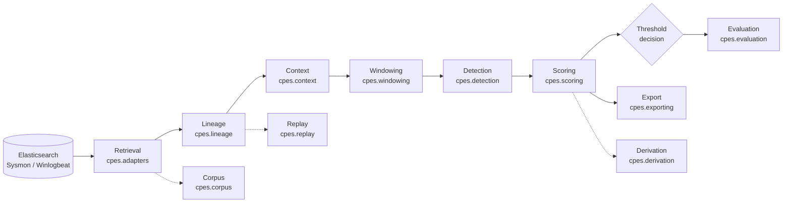

<div align="center">

# Contextual Privilege Escalation Scoring

**CPES**

Automated, interpretable, chain-level scoring for runtime
privilege-escalation detection on a single Windows endpoint.


</div>

---

CPES ingests Sysmon/Winlogbeat telemetry via Elasticsearch, reconstructs
process lineage, builds cross-channel context, and produces deterministic,
evidence-backed detection scores and threshold decisions — instead of a
single-event signature match, it reasons over the whole chain of events
around a privilege gain.

> This is an active research codebase, not a packaged product. Interfaces
> and scoring behavior may change as the methodology is developed and
> validated.

## Contents

- [Architecture](#architecture)
- [Results](#results)
- [Prerequisites](#prerequisites)
- [Local Python setup](#local-python-setup)
- [Running the demo](#running-the-demo)
- [Tests](#tests)
- [Reproducibility records](#reproducibility-records)
- [Documentation](#documentation)
- [Status](#status)

## Architecture

The pipeline is a set of backend-neutral components coordinated by
`CpesPipeline` (see [orchestration-pipeline.md](docs/orchestration-pipeline.md)).
Each stage accepts caller-supplied inputs and has no hidden defaults,
fallbacks, or implicit I/O.



| Stage | Package | Role |
|---|---|---|
| Retrieval | `cpes.adapters` | Elasticsearch adapter, canonical event mapping, and evidence-record mapping for named pipes (EID 17/18) and remote threads (EID 8) |
| Lineage | `cpes.lineage` | Structural process-lineage reconstruction |
| Context | `cpes.context` | Cross-channel context building and resolution |
| Windowing | `cpes.windowing` | Time/window management over context; attaches cross-channel evidence to windows |
| Detection | `cpes.detection` | Generic and technique-scoped signal emission |
| Scoring | `cpes.scoring` | Deterministic, additive signed-evidence scoring |
| Derivation | `cpes.derivation` | Evidence, fold, tuning, and validation policy |
| Evaluation | `cpes.evaluation` | Metrics and evaluation harness |
| Replay | `cpes.replay` | Deterministic replay of recorded runs |
| Corpus | `cpes.corpus` | Corpus recording, coverage, and audit utilities |
| Export | `cpes.exporting` | Structured export of pipeline artifacts |

See the per-milestone design docs in [`docs/`](#documentation) for the exact
contract each component implements.

## Results

Evaluated on a lab-collected Sysmon corpus from one Windows 11 endpoint (UAC,
service-creation, thread injection, and token-theft privilege escalation, plus
blind benign activity; corpus not included in this repository). 2,161 process
instances: 87 attack outcomes, 2,074 benign. Full generated tables:
[docs/RESULTS.md](docs/RESULTS.md).

**Leakage-free grouped 5-fold CV** (folds split by attack run), mean ± sd over folds:

| Detector | Precision | Recall | F1 |
|---|:---:|:---:|:---:|
| **CPES** | 0.986 ± 0.029 | 1.000 ± 0.000 | **0.993 ± 0.015** |
| Single-event integrity-edge baseline | 0.982 ± 0.036 | 0.404 ± 0.163 | 0.551 ± 0.136 |
| IOC / signature baseline | 1.000 ± 0.000 | 0.567 ± 0.194 | 0.705 ± 0.151 |

Ungrouped 5-fold CV gives CPES 0.995, baselines 0.519 / 0.736 (supporting
figures). Grouping benign activity by lineage chain as well changes CPES to
0.996 ± 0.008 (no leakage effect).

What these numbers do and do not show:

- **Recall is favourable by construction.** Attack outcomes are labelled by
  their own mechanism signal at known attack times. With labels taken only
  from the execution log times, CPES flags a technique-consistent process in
  **98 of 126** logged runs with one false-alarm process.
- **The injection signal is an image rule on this corpus.** No
  `CreateRemoteThread` was recorded from `mavinject.exe`; the signal fires on
  the `mavinject.exe` image itself, as the IOC baseline does.
- **Two engines.** The figures above come from the research analysis scripts.
  The `cpes` package engine, with the new evidence channels, reaches grouped-CV
  F1 **0.684** on the same folds (injection 0/18, UAC 15/33 because the corpus
  export capped registry events, 12 benign service flags from a rule
  difference). Details and the pre-registered expectations:
  [docs/design/evidence-channels-and-package-evaluation.md](docs/design/evidence-channels-and-package-evaluation.md).
- **Provenance-labelled run-level evaluation** on the combined corpus gives
  CPES F1 0.505 ± 0.104: lineage provenance loses the outcome processes the OS
  re-parents (services under `services.exe`), which is the problem CPES's
  cross-channel re-association addresses and also a limit of that label.

- **Blind-validated precision** — 1 false positive across 2,074 benign
  process-units evaluated independently of the signal set (FPR ≈ 0.0005).
- **Generalization ablation** — with each technique's specific signal held
  out, the generic "unexplained privilege gain" detector still catches
  **33 / 33** UAC escalations from context alone, at a cost of ~1 false
  positive on benign activity. It does not catch service/injection/token
  escalations by construction — those techniques produce no integrity edge
  for a generic test to see, which is why the technique-specific signals
  exist.
- **Honest-miss check** — three privilege-escalation techniques with no
  implemented signal (scheduled task, Run-key persistence, WMI event
  subscription) were executed and correctly produced zero detections, i.e.
  CPES doesn't over-fire on nearby-but-unmodeled activity (expansion corpus v4;
  not re-run in this checkout because that corpus is only archived).

### Beyond the lab: external data, evasion, live scoring, Sigma

Each test below was written down with its expected outcome before it ran
([design notes](docs/design/external-and-evasion-evaluation.md)); full tables in
[docs/RESULTS.md](docs/RESULTS.md) §6–9.

| Question | Result |
|---|---|
| **Does it work on attacks it has never seen?** 53 public Sysmon captures ([EVTX-ATTACK-SAMPLES](https://github.com/sbousseaden/EVTX-ATTACK-SAMPLES)), weights frozen from the lab | CPES alone: **9/53**. CPES + its generic "unexplained privilege gain" test: **26/53**. The list-based UAC signal does not generalise (2/33 UAC methods). The *structural* service signal (a SYSTEM process running from a user-writable path) caught 5 of 7 Potato/PrintSpoofer-style token attacks it was never designed for. |
| **Does renaming tools evade it?** Attacker-controlled changes to the lab telemetry | Renamed injector: the research injection signal and the IOC rule drop 18/18 → **0/18** (both are name rules). Renamed service binary, random pipe names, obfuscated command lines: **no change**. Switching to an unlisted auto-elevating binary: CPES UAC 33/33 → **0/33**, while the generic test rises to **32/33**. |
| **Can it run live?** Lab corpus replayed as a stream | Live alerts equal the hindsight result exactly (**160/160**). Time to alert: median **83 s**, max 151 s of event time. Under 1 s of compute per closed window. |
| **How does it compare with SigmaHQ?** 850 core / 1,927 total Sysmon rules on the same data | Sigma detects **more**: 106/126 lab runs (CPES 98/126) and 42/53 external files, with similar noise outside attack runs. Sigma alerts on the *actor* (`reg.exe`, `sc.exe`). CPES names the process that **gained** privilege and shows the mechanism (Sigma flags 0/33 elevated UAC processes and 0/28 service binaries). |

**Positioning, stated plainly:** CPES does not out-detect a mature community
rule set on breadth. It complements one: it tells an analyst *which process
ended up elevated, by which mechanism, with the evidence chain*, and its generic
unexplained-gain test covers elevation through binaries no rule names. Combining
the specific signals with a weighted generic test is the next design, to be
evaluated on data it was not tuned on.

Reproduce everything (lab protocols need the private corpus; external data is
public — `python scripts/fetch_external.py` downloads and verifies it):

```powershell
python -m evaluation.run all
python -m evaluation.report      # regenerates docs/RESULTS.md
```

## Prerequisites

- A frozen Windows 11 lab VM; record its exact build.
- Elasticsearch, Kibana, and Winlogbeat 9.4.3.
- Sysmon 15.20 (configuration in `configs/sysmon-config-v1.xml` / `v2.xml`).
- Python 3.12.

## Local Python setup

```powershell
py -3.12 -m venv .venv
.\.venv\Scripts\Activate.ps1
pip install -r requirements.txt
```

## Running the demo

`demo/cpes_demo.py` prints a terminal report computed from the lab corpus
(`analysis/corpus-v3.ndjson`, private, not in the repository) with the
standard library only; its figures are pooled and in-sample. See
[demo/README.md](demo/README.md). Without the corpus, use the research
dashboard with the synthetic sample.

```powershell
python demo/cpes_demo.py
```

## Research dashboard

`dashboard/` is a local web application over the unchanged package: upload
and validate telemetry, explore raw records, run `CpesPipeline`, trace each
detection to its signals, weights and source records, inspect process lineage,
and re-run the `analysis/` evaluation scripts with recorded provenance. See
[dashboard/README.md](dashboard/README.md).

```powershell
pip install -r dashboard/requirements.txt
cd dashboard/web; npm ci; npm run build; cd ../..
python dashboard/run_server.py      # http://127.0.0.1:8790
```

## Tests

```powershell
pytest tests
pytest dashboard/tests
```

## Reproducibility records

Before corpus collection, copy the fields in
[environment-record-template.md](docs/environment-record-template.md) into
the experiment record and complete the checklist in
[m0-validation.md](docs/m0-validation.md). Keep generated telemetry,
credentials, and machine-specific configuration outside version control.

## Documentation

Milestone design and validation docs live in [`docs/`](docs), in build order:

| Doc | Covers |
|---|---|
| [m0-validation.md](docs/m0-validation.md) | Environment validation checklist |
| [m1-sysmon-eid-justification.md](docs/m1-sysmon-eid-justification.md) | Sysmon config justification |
| [m2-corpus-generation.md](docs/m2-corpus-generation.md) · [m2-corpus-release.md](docs/m2-corpus-release.md) | Corpus generation and release procedure |
| [m3-telemetry-validation.md](docs/m3-telemetry-validation.md) | Telemetry validation procedure |
| [m4-lineage-reconstruction.md](docs/m4-lineage-reconstruction.md) | Structural lineage reconstruction |
| [m5-context-windowing.md](docs/m5-context-windowing.md) | Context and windowing contract |
| [m6-cpes-scoring.md](docs/m6-cpes-scoring.md) | Deterministic scoring contract |
| [m7-retrieval-replay.md](docs/m7-retrieval-replay.md) | Retrieval adapter and replay driver |
| [m8-evidence-derivation.md](docs/m8-evidence-derivation.md) | Evidence derivation policy |
| [orchestration-pipeline.md](docs/orchestration-pipeline.md) | End-to-end pipeline coordination |
| [CPES-Context-Resolver-Design-2026-09-06.md](docs/CPES-Context-Resolver-Design-2026-09-06.md) | Context resolver design |

The `cpes/` package intentionally contains only architecture-aligned
modules; configuration lives in `configs/`, and reproducibility scaffolding
for a named telemetry corpus lives in `corpus/`.

## Status

<div align="center">

**Private research repository — active development**

Generated telemetry, evaluation corpora, and internal working notes are
kept outside version control.

</div>
